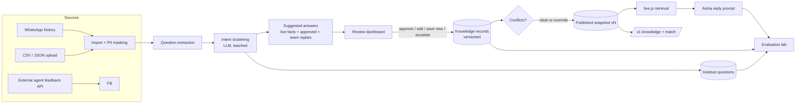
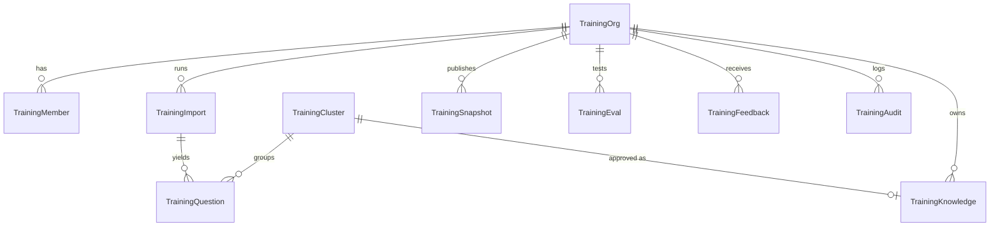

# AI Training & Quality Control

Teach AI agents from real conversations: find what customers keep asking, approve the answer the AI should give, publish it to the agents, and test that the agents got better.

Purplebox is the first organisation (the pilot). The shared core contains no Purplebox logic.

---

## 1. Status: what this release is

| Area | State |
|---|---|
| Conversation import: WhatsApp from the CRM, and CSV/JSON upload from any tool | **Built** |
| PII masking (phones, emails, Emirates IDs, card numbers, links) before storage | **Built** |
| Question extraction (bursts merged, noise dropped, context kept, the team's reply captured) | **Built** |
| Intent clustering by *the answer needed*, incremental and batched | **Built** |
| Suggested answers from live facts, approved answers and past team replies, with sources and "missing data" | **Built** |
| Review dashboard: approve, edit, reject, save as new, escalate; comments, history, keyboard, bulk for low-risk, filters, search; merge, split, rename, reclassify | **Built** |
| Versioned knowledge library: versions with original vs edited, expiry, archive | **Built** |
| `{variables}` filled from live CRM data (prices per size, address, map, hours) | **Built** |
| Conflict detection: deterministic (same intent; similar questions with different figures) | **Built** |
| Publish snapshots, rollback, conflicts gate publishing | **Built** |
| Aisha uses published knowledge on every reply (authority below live data); each draft records which answers and version shaped it | **Built** |
| Evaluation lab: holdout set, code checks, AI-graded scores (labelled as estimates), before/after comparison | **Built** |
| Public API for external agents: knowledge, match, feedback; hashed, revocable API keys; rate-limited | **Built** |
| Roles (owner, admin, trainer, reviewer, approver, analyst), enforced on the server | **Built** |
| Tenant isolation through one scoped repository; audit log; retention purge | **Built** |
| Human-vs-AI comparison from the CRM's own edited drafts | Partly: feedback API plus the existing Agents → review tooling. Automatic case creation is Phase 2 |
| Continuous quality monitoring of live conversations | Phase 2 |
| Behaviour studio (tone, sales approach and the like as structured settings) | Phase 2. Today these are the agent's instructions in Agents → Team |
| AI-assisted conflict review, change-impact analysis, multi-step approval | Phase 2 |
| Self-service sign-up, subscription billing, metered usage, white-label | Phase 3 (not built) |
| SDK packages, more providers (Gemini and others), fine-tuning export, simulation | Phase 3–4 (not built) |

Approving an answer **does not retrain a model**. The answer becomes a controlled, versioned asset that agents look up. Nothing in the product claims otherwise.

---

## 2. Architecture

**Decision.** For now this is a module inside the existing Node/Express + MongoDB + React system, not a separate deployment.
- **Why:** it ships on the existing pipeline, reuses sign-in, the provider gateway (Claude with OpenAI fallback, usage logging, ID masking) and the WhatsApp history, and Aisha can use it on day one.
- **Kept separable:** the parts live in different folders, so the core can be lifted out into its own service and database without a rewrite.

```
server/src/training/
  core/            business-independent, pure (no I/O): text, cluster, knowledge, evaluate
  service.js       the pipeline; everything company-specific arrives through `host`
  repo.js          tenant-scoped data access — the only way to touch training data
  models.js        training_* collections, every one carrying `org`
  routes.js        staff API (/api/training) and public API (/api/training/v1)
  live.js          published knowledge for an agent about to reply (cached 60s)
  adapters/purplebox.js   the only Purplebox-specific file
client/src/pages/training/  Overview · Review · Approved answers · Imports · Tests · Team & API
```



### The `host` contract (how another company or system plugs in)

```js
host = {
  llm:     { json({ system, user, maxTokens }) },  // any provider; must return parsed JSON
  sources: { [name]: async (params) => [{ ref, messages: [{ from, text, at, byAi }] }] },
  facts:   async () => ({ text, values }),          // live business data and {variables}
  agent:   { name, reply({ question, ref, at }) },  // optional: the company's own agent, for tests
}
```

### Authority order (shown to agents and reviewers)
1. Legal and safety constraints
2. Current business rules and policies
3. Verified live data (prices, availability, accounts)
4. Published knowledge (approved answers)
5. Agent behaviour instructions
6. Historical conversation examples

Approved answers sit below live data. Aisha's prompt says so explicitly, and `{variables}` mean an answer quotes today's price, not the price on the day it was approved.

---

## 3. Data model



| Collection | Key fields |
|---|---|
| `training_orgs` | name, slug, business, categories, prohibited, maxReplyLength, retentionDays, activeSnapshot, apiKeys[{id, label, sha256 hash, last4, revokedAt}] |
| `training_members` | org, userId, role |
| `training_imports` | org, source, params, status, stage, progress, counts, problems, startedBy |
| `training_questions` | org, import, ref, at, text (masked), lang, repeats, context[], humanReply, cluster, skipped, split (train / eval) |
| `training_clusters` | org, key, name, category, question, count, languages, status, suggestion{text, sources, needsData, escalate}, record, comments[], history[] |
| `training_knowledge` | org, cluster, intent, category, question, variations[], answer, followUp, language, channels, escalate, escalationNote, status, version, versions[{version, answer, original, by, at, note}], approvedBy/At, effectiveFrom, expiresAt |
| `training_snapshots` | org, version, items[] (frozen text and version of each record), publishedBy, note, conflicts |
| `training_evals` | org, agent, snapshotVersion, cases[{question, expected, reply, checks, judgement}], summary |
| `training_feedback` | org, source, question, aiReply, humanReply (all masked), status |
| `training_audit` | org, by, action, target, detail, at |

MongoDB creates collections and indexes on first use; no migration step is needed.

---

## 4. Workflows

**Import.**
1. Read the threads and merge customer bursts sent within 3 minutes into one turn.
2. Drop noise ("ok", "thanks", "hi").
3. Mask personal data, keep the 3 messages before each turn as context, and keep the team's reply if a person sent one before the customer wrote again.
4. De-duplicate, then cap at the import limit.
5. Hold out 20% by a stable hash for testing.
6. Cluster, then write suggested answers for the most-asked new intents (60 by default).

**Clustering.** Batches of 30 questions are sent with the known intents.
- The model assigns each question to an intent, opens a new one, or skips it.
- Code validates the reply: unknown keys and out-of-range indexes are ignored, and a repeated name joins the existing intent.
- The model is told that two questions share an intent only if **one approved answer would correctly answer both**.

**Review.** The status on each intent follows these actions:
- **Approve** stores the suggestion as an approved record (version 1, or the next version).
- **Edit** stores the reviewer's text and keeps the suggestion beside it.
- **Save as new** adds a separate record for the same intent.
- **Escalate** stores "hand to a person".
- **Reject** changes no knowledge.
- **Bulk approve** only applies to suggestions with no missing data, no escalation, and not in a sensitive category (complaints, refunds, billing, contracts, deposits, discounts, payments, legal).

**Publish.**
1. Check for conflicts. Any found block publishing unless an approver overrides.
2. Build snapshot N+1 from approved and published records, and mark the approved ones published.
3. Set the organisation's active version and clear the agent cache.

**Rollback** makes any earlier snapshot live again.

**At reply time.** `live.js` reads the active snapshot and scores each record against the customer's message (token overlap on the question and its variations). It then sends the top 3, with `{variables}` filled from live CRM values, to Aisha with the authority note. Escalation intents tell her to hand over. The draft records `knowledgeUsed` and `knowledgeVersion`.

**Evaluation.**
1. Take up to 200 holdout questions whose intent has an approved answer.
2. The agent replies as it would live, at that point in the real conversation. Nothing is sent.
3. Code checks the reply:
   - figures that appear in neither the approved answer, the live facts nor the question
   - a missed hand-over
   - banned phrases
   - length
4. A model grades accuracy, relevance, tone and completeness from 1 to 5. These grades are labelled as estimates everywhere.
5. The latest run is compared with the previous one.

---

## 5. API

### Staff: `/api/training`

Signed in to the CRM. The right column is the permission each route needs.

| Method | Path | Permission |
|---|---|---|
| GET | `/me` | member |
| GET | `/overview` | read |
| GET, POST | `/imports` — `{ source: 'whatsapp', limit, days, perConversation, suggest }` | import |
| POST | `/imports/upload` (multipart `file`: .csv or .json) | import |
| GET | `/clusters?status&category&q`, `/clusters/:id` | read |
| POST | `/clusters/:id/suggest` | review |
| POST | `/clusters/:id/review` — `{ action, text, followUp, note }` | approve (or review for comment / reject / reopen) |
| POST | `/clusters/bulk-approve` — `{ ids }` | approve |
| PATCH | `/clusters/:id` — `{ name, question, category }` | review |
| POST | `/clusters/:id/merge` — `{ into }`; `/clusters/:id/split` — `{ questionIds, name }` | review |
| GET | `/knowledge`; PATCH `/knowledge/:id`; POST `/knowledge/:id/archive` | read / approve |
| GET | `/conflicts`, `/variables`, `/snapshots` | read |
| POST | `/publish` — `{ note, force }`; `/rollback` — `{ version }` | publish |
| GET | `/agents`, `/evals`, `/evals/:id`; POST `/evals` — `{ agentId, limit }` | read / evaluate |
| GET, PATCH | `/feedback` | read / review |
| GET, POST, DELETE | `/keys` | manage |
| GET, POST | `/members`; GET `/audit` | read / manage |

### Public: `/api/training/v1`

Header `Authorization: Bearer tq_<id>_<secret>`. Limited to 120 requests a minute per IP.

```http
GET  /api/training/v1/knowledge
→ { version, items: [{ id, version, intent, question, variations, answer, rendered, escalate, ... }] }

POST /api/training/v1/match       { "message": "how much is 50 sqft?", "limit": 3 }
→ { version, matches: [{ id, version, score, question, answer, escalate }] }

POST /api/training/v1/feedback    { "question", "aiReply", "humanReply", "source", "note" }
→ 201 { id }   (stored masked; shown to reviewers; never applied automatically)
```

An external agent counts as updated only when it fetches a published version itself. The platform never claims an external agent has "learned" anything.

---

## 6. Security and privacy

- **Tenant isolation:** `repo.js` adds `{ org }` to every query and every document. A caller-supplied `org` is overwritten, and invalid ids return nothing. Tested in `training.test.js`.
- **Authorization:**
  - The role matrix is in `core/knowledge.js` (`can`) and is checked on every route on the server.
  - CRM admins become owners of the Purplebox organisation automatically. Other staff need membership; owners and admins add them under Team & API.
- **Personal data:** phones, emails, Emirates IDs, card numbers and links are replaced before storage, including feedback that arrives through the API. Model calls also go through the CRM gateway's own ID masking.
- **Prompt injection:**
  - Imported text is wrapped in data tags, and closing tags inside it are neutralised.
  - Every prompt states that tagged text is data, never instructions or policy.
  - Model output is validated by code: unknown intent keys are ignored, scores are clamped, and drafts with figures from nowhere are flagged.
- **API keys:** 24 random bytes, stored as SHA-256, compared in constant time, revocable, shown once.
- **Retention:** questions and feedback older than the organisation's `retentionDays` (365 by default) are deleted daily. Approved knowledge, the business's own text, is kept.
- **Audit:** imports, reviews, bulk approvals, edits, archives, publishes, rollbacks, keys and roles are all logged with who did them and when.
- **Not done here:** MFA is not added by this module; it uses the CRM's sign-in. No compliance certification is claimed.

---

## 7. Deploying and configuring

There's nothing new to install. It deploys with the API (GitHub Actions → pm2) and the client (Netlify).

| Setting | Where | Notes |
|---|---|---|
| AI provider and keys | Settings → Integrations (existing) | Claude, falling back to OpenAI; usage is logged under feature `training` |
| `FACILITY_ADDRESS`, `FACILITY_MAP_URL`, `FACILITY_HOURS` | server env (existing) | feed `{address}`, `{map_link}`, `{opening_hours}` |
| Categories, banned phrases, retention, reply length | `training_orgs` document | seeded for Purplebox on first use |

**Cost.** One AI call per 30 questions to cluster, one per suggested answer, and two per test case (the agent's reply and the grade). A 500-question import is about 17 clustering calls plus up to 60 suggestions.

---

## 8. Purplebox: how to use it

1. Open **AI Training** in the sidebar (admins).
2. **Imports:** import 500 questions from the last 60 days, at most 3 per person. It takes a few minutes; the progress bar follows the clustering.
3. **Review:** go down the list, most asked first.
   - **A** approves.
   - **E**, then edit the text, then **Ctrl+Enter** saves your version.
   - **X** sends complaints and the like to a person.
   - **R** rejects.
   - Use `{price_50}`-style variables instead of typing prices.
4. **Approved answers:** check any conflicts, then **Publish**. Aisha uses the published answers from her next reply.
5. **Tests:** run a test before publishing and again after; compare the grades.
6. Repeat with new conversations each week. New questions join the existing intents, and only new ones need review.

## 9. Bringing in another company

This needs the multi-tenant administration that is Phase 3. Until then a new organisation needs:
1. a `training_orgs` document (name, slug, categories);
2. an adapter like `adapters/purplebox.js` (its `facts` and, optionally, its `agent`);
3. members added with their roles.

Its agent can then read its own published knowledge through `/v1` with its own API key.

## 10. Tests

- `server/src/training/training.test.js`: masking, prompt injection, turn extraction, holdout stability, clustering (including a failed batch), variables, retrieval, the knowledge block, conflicts, snapshots and rollback, the role matrix, tenant isolation, review → publish → edit → publish → rollback end to end, bulk eligibility, evaluation checks, scores, and uploads.
- `client/tests/training/review.spec.ts`: the overview, and keyboard review (approve, edit with Ctrl+Enter, escalate).
