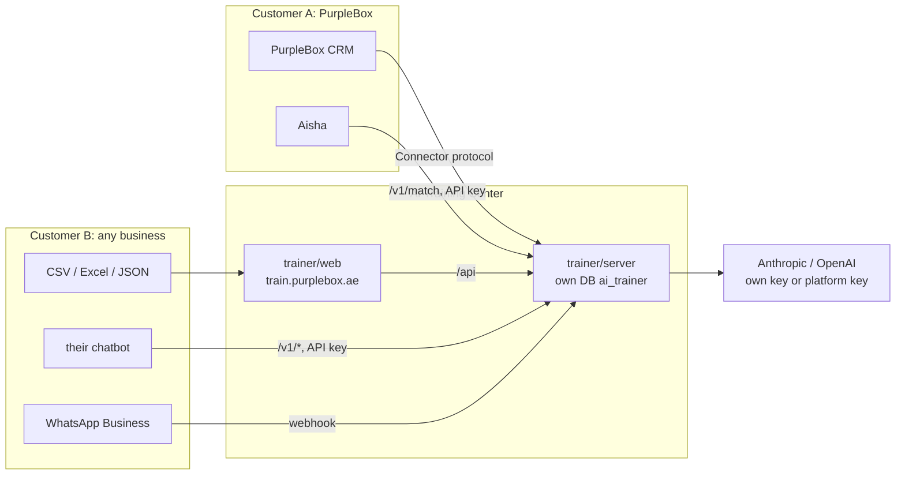

# AI Training Center

A separate, multi-tenant product: any business signs up, brings in its real customer conversations, finds what customers keep asking, approves the answer its AI should give, publishes those answers to its AI agent, and tests that the agent got better.

**PurpleBox is one customer organisation**, connected the same way any other business would be.

| | |
|---|---|
| Website | `trainer/web` → its own Netlify site at **train.purplebox.ae** |
| API | `trainer/server` → its own process (`pm2 ai-trainer`, 127.0.0.1:5020) and its own database (`ai_trainer`) |
| Public address | the website's `/api/*` → `https://api.purplebox.ae/trainer-api/*` → the trainer process |
| PurpleBox's link to it | the CRM implements the Connector protocol (`/api/training-connector`); Aisha reads published answers with a Training Center API key |

---

## 1. What exists in this release

| Area | State |
|---|---|
| Sign up, sign in, sessions; the first account is the platform admin | **Built** |
| Organisations (one per customer business), switcher, "new organisation", invitations by link, 6 roles enforced on the server | **Built** |
| Conversations in: connected system (Connector protocol), CSV/Excel/JSON upload, `POST /v1/conversations`, WhatsApp Business webhook | **Built** |
| Personal data masked before storage (phones, emails, Emirates IDs, cards, links); phone numbers never leave the PurpleBox CRM (opaque references) | **Built** |
| Question extraction, intent clustering by *the answer needed*, 20% holdout | **Built** |
| Suggested answers from the organisation's live facts, `{variables}`, approved answers and past team replies — with sources and "missing data" | **Built** |
| Review: approve, edit, reject, save as new, escalate; keyboard; bulk for low-risk; comments; history; merge, split, rename | **Built** |
| Versioned answer library, conflict check, publish snapshots, rollback | **Built** |
| Tests: the organisation's **own** AI (through its connector) or the **hosted** agent; code checks plus AI-graded scores labelled as estimates; before/after | **Built** |
| Bring-your-own AI key (Anthropic or OpenAI, verified, stored encrypted) or the platform key; usage counted per organisation, feature and model | **Built** |
| Public API by key: knowledge, match, feedback, conversations | **Built** |
| Platform admin: all organisations, their usage, plan label, platform keys, sign-up on/off | **Built** |
| Export an organisation's data; delete an organisation and everything in it; daily retention purge; audit log | **Built** |
| **Sales playbook** as configuration: behaviour contract, conversation states, Next Best Actions, lead fields, weighted scorecard, automatic fails, media library, scenario groups, graduation gates. Templates: general customer service, and self-storage sales (the PurpleBox AI Sales Training & Deployment Specification v1.0) | **Built** |
| **Scenario library** in the spec's dataset format (context, message, lead state before, intent, correct actions, ideal reply, weak reply, critique, outcome, commercial note); coverage against the test matrix; 74 starter scenarios as drafts; AI-drafted scenarios and ideal replies, always approved by a person | **Built** |
| **Sandbox**: chat as a customer; lead-state viewer with confidence, conversation state, Next Best Action and reason, knowledge trace, media and actions simulated (nothing sent); score, approve or correct any reply — corrections become regression cases | **Built** |
| **Scenario suite**: weighted 0–100 score, code-checked automatic fails (invented figures, unlisted discounts, missed hand-overs), regressions against the last run, the eight graduation gates, blind human review; each run records model, playbook version and knowledge version | **Built** |
| **Go-live stages** Sandbox → A Shadow → B Human approval → C Limited → D Expanded → E Optimised; past Shadow only one stage at a time on a run that passes every gate; shared by `GET /v1/rollout` | **Built** — the stage is advisory: the business's own system decides what it sends |
| Production monitoring of visits, bookings, discounts and revenue by model version (Specification §19) | Not built — needs outcome data from the business's system |
| Billing (Stripe subscriptions, metered usage invoices), quotas per plan | Not built — plans are a label today; usage is counted, ready to bill |
| Live quality monitoring, behaviour studio, human-vs-AI auto cases, SDK packages, more providers, fine-tuning export | Not built (Phases 2–4) |

Approving an answer **does not retrain a model**. The answer becomes a controlled, versioned asset that agents look up, ranked below each business's live data.

---

## 2. How a business uses it

1. **Sign up** at train.purplebox.ae. This creates the account and its organisation. Invite the team under Settings → Team.
2. **Settings → Business:** describe the business, paste its facts (prices, hours, policies), and add `{variables}`.
3. **Settings → AI provider:** paste its own Anthropic or OpenAI key, or leave it on the platform key.
4. **Bring in conversations** in one of four ways:
   - **Connected system:** its CRM or helpdesk implements four endpoints. This also gives live facts and lets the Training Center test the business's own AI.
   - **Upload** a CSV, Excel or JSON file.
   - **API:** `POST /api/v1/conversations` with an API key.
   - **WhatsApp Business:** set the webhook in Meta. Messages collect from then on; Meta does not share older history.
5. **Conversations → Import:** questions are grouped and suggested answers written.
6. **Review:** decide each common question.
   - **A** approves.
   - **E** edits, then **Ctrl+Enter** saves.
   - **X** sends it to a person.
   - **R** rejects.
7. **Approved answers → Publish.** Its agent reads them by API key (`/v1/match` or `/v1/knowledge`), or the hosted agent uses them.
8. **Tests:** run a test before and after publishing.

**Sales agents (the playbook):**

1. **Settings → Playbook:** start from a template (self-storage sales brings 74 starter scenarios as drafts), then adjust the contract, actions, scorecard and gates.
2. **Scenarios:** fill in or **Draft with AI** each ideal reply, check the correct action, and **Approve**. Coverage cards show each group against the matrix minimum; the wand drafts 8 more for a group.
3. **Sandbox:** chat as a customer, or open a scenario and **Replay** it. **Score**, **Approve** or **Correct** any reply.
4. **Tests & go-live → Run** the core suite. Read the gates, do a **Blind review** (20+ ratings), correct failing cases, and run again.
5. When every gate passes, move one stage at a time. Shadow needs no gates, because it sends nothing.

### PurpleBox, as a customer

1. Sign up at train.purplebox.ae with organisation name **PurpleBox Storage**. The first account becomes the platform admin.
2. **CRM → Settings → Integrations → AI Training Center → Make a token.** Paste the address and token into the Training Center under **Settings → Connected system**.
3. **Training Center → Settings → API → New key.** Paste it into the CRM card under **"Let Aisha read the approved answers"**.
4. **Conversations → Connected system → Import 500.** Then review, publish and test as above.
   - Aisha uses the published answers from her next reply.
   - Live CRM prices fill `{price_50}`-style variables, because the connector serves the CRM's live facts.

---

## 3. Architecture



```
trainer/server/src
  core/          business-independent and pure: text (masking, extraction, injection guard), cluster, knowledge, evaluate
  service.js     the pipeline: import → cluster → suggest → review → publish → evaluate
  repo.js        tenant-scoped data access (adds { org } to every query and document)
  host.js        one organisation's model, sources, facts and agent
  providers.js   Anthropic (official SDK, claude-opus-5-5 by default, server-side refusal fallback) and OpenAI; BYOK; usage
  connector.js   the Connector protocol client; https-only, no private addresses
  security.js    AES-256-GCM for stored secrets, sessions, hashing
  routes/        auth, org (settings, team, keys, usage, export, delete), training, platform, public (v1 + webhooks)
trainer/web/src  React app: sign-in, shell with organisation switcher, Overview, Review, Approved answers, Conversations, Tests, Settings, Platform
```

### Connector protocol

This is what a customer's own system implements. Every call carries `Authorization: Bearer <token>`.

```
GET  {base}/health                        → { ok: true, name }
GET  {base}/conversations?days&limit      → { threads: [{ ref, messages: [{ from: 'customer'|'agent', text, at, byAi }] }] }
GET  {base}/facts                         → { text, values: { name: value } }
POST {base}/agent-reply { question, ref, at, context? } → { reply, needsHuman, tools? }
```

`context` is a sandbox conversation `[{ from, text }]`. When it is present, the agent answers from that conversation instead of a real customer's history; the PurpleBox CRM does this with `persist: false`, so nothing is sent or saved.

PurpleBox's implementation is `server/src/routes/trainingConnector.js`. Its references are keyed hashes of the phone number, so no number is sent.

### Public API (per organisation, `Authorization: Bearer tq_<id>_<secret>`)

```
GET  /api/v1/knowledge                     published answers, {variables} filled
POST /api/v1/match         { message, limit }
POST /api/v1/conversations { conversations: [{ conversation, messages: [{ from, text, at, id }] }] }   (≤2,000 messages/call, deduplicated by id)
POST /api/v1/feedback      { question, aiReply, humanReply }
GET  /api/v1/rollout                       { stage, intents, contract }   contract only when the owner shares it
POST /api/webhooks/whatsapp/:orgId         Meta deliveries, verified with the app secret
```

### Authority order (shown to agents)

Legal and safety > current business rules > verified live data > published answers > agent instructions > past conversations.

---

## 4. Security

- **Tenant isolation:**
  - Every request names its organisation with the `X-Org` header.
  - The server checks membership and role before reading anything.
  - All training data goes through `repo.js`, which adds `{ org }` to every query and document; a caller-supplied `org` is overwritten.
  - API keys resolve to exactly one organisation.
- **Roles:**
  - owner and admin: everything (only an owner deletes the organisation)
  - trainer: import, review, test
  - reviewer: review and comment
  - approver: approve, publish, test
  - analyst: read only
  - The platform admin can open any organisation for support, as admin, and it is logged.
- **Secrets:**
  - AI keys, connector tokens and WhatsApp app secrets are AES-256-GCM encrypted with `TRAINER_SECRET` and only ever shown as their last four characters.
  - API keys and invitation tokens are stored as SHA-256 and shown once.
  - Passwords use bcrypt; sessions last 14 days.
- **Outbound calls:** connector addresses must be https and must resolve to public IPs, so they can't reach 127.0.0.1, private ranges or cloud metadata. Redirects are not followed.
- **Webhooks:** each WhatsApp delivery is verified by HMAC-SHA256 with the organisation's app secret.
- **Prompt injection:**
  - Imported text is wrapped in data tags, with any closing tags inside it neutralised.
  - Every prompt states that this text is data, not instructions.
  - Model output is validated by code.
- **Privacy:** data is masked before storage; retention is configurable per organisation and purged daily; an organisation's data can be exported and deleted.
- **Rate limits:** sign-up and sign-in, 30 per 15 minutes; public API, 240 per minute.
- **Not done here:** MFA. No compliance certification is claimed.

---

## 5. Running it

**On the PurpleBox server** this is automatic. `server/deploy.sh`:
1. installs `trainer/server`;
2. creates `trainer/server/.env` once: the same MongoDB cluster under database `ai_trainer`, a random `TRAINER_SECRET`, and `PORT=5020`;
3. runs `pm2 ai-trainer` and health-checks it.

The CRM API forwards `/trainer-api/*` to it.

**Website.** Create a Netlify site from this repository:
- **Base directory:** `trainer/web`
- **Build:** `npm run build`
- **Publish:** `dist`
- **Domain:** add `train.purplebox.ae`, then create the DNS record Netlify shows (a CNAME to the site).

`trainer/web/netlify.toml` already forwards `/api/*`.

**Locally:**
```
cd trainer/server && cp .env.example .env   # set TRAINER_MONGODB_URI and TRAINER_SECRET
npm install && npm run dev                   # :5020
cd trainer/web && npm install && npm run dev # :5180, proxies /api
```

**Environment** (`trainer/server/.env`): `PORT`, `TRAINER_MONGODB_URI`, `TRAINER_DB_NAME`, `TRAINER_SECRET`, `TRAINER_WEB_ORIGINS`, and optional `ANTHROPIC_API_KEY` / `OPENAI_API_KEY` as a fallback platform key. `CONNECTOR_ALLOW_LOCAL=1` is for local development only.

**CRM side** (`server/.env`, written by its Settings card): `TRAINING_CONNECTOR_TOKEN`, `TRAINER_API_KEY`, and `TRAINER_API_URL` (default `http://127.0.0.1:5020/api/v1`).

## 6. Tests

- `trainer/server`: `npm test`. Covers:
  - the core: masking, injection, extraction, clustering, variables, retrieval, conflicts, snapshots and rollback, roles, tenant scoping, review → publish → rollback, evaluation;
  - security: encryption and tampering, sessions, passwords, the private-address guard, webhook signatures, secrets never returned;
  - HTTP: every organisation route refuses without a session, and the public API refuses without a key.
- `trainer/server` also covers the playbook: the spec's states, actions, weights and gates; cleaning a saved playbook; weighted scores; code-caught automatic fails; pass rules; gates (pending vs failing); regressions; stage moves; starter scenarios; and sandbox turns and a suite run against a fake model.
- `trainer/web`: `npx playwright test` (mocked API). Covers sign-up, switching organisations (every request carries the chosen one), keyboard review, the sandbox (reply, lead state, trace, score, correction, lead carried forward), scenarios (coverage, AI draft, approve), gates and blind review, and playbook settings.
- CRM: `server/src/services/trainerKnowledge.test.js` and `server/src/routes/trainingConnector.test.js`.
- **Not yet tested:** the full flow against a live database and a live model. Run it once on the server after the first deploy.
